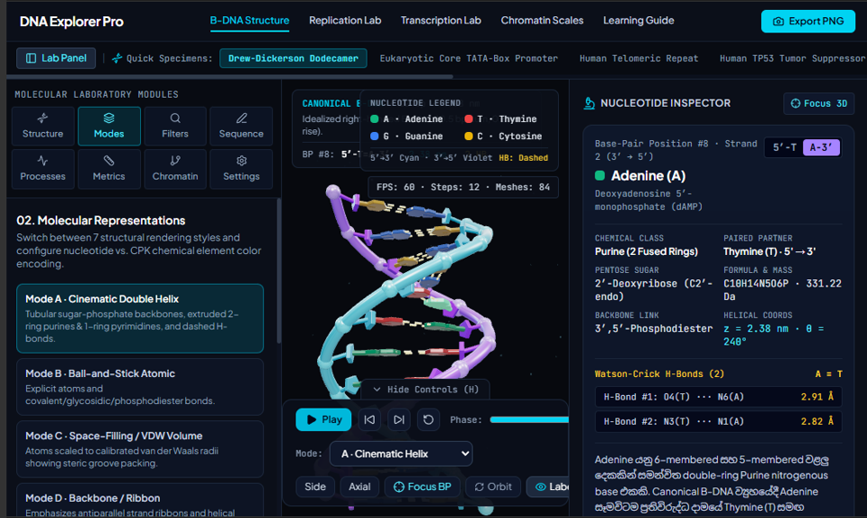

# 🧬 DNA Explorer Pro

**Interactive 3D DNA and molecular biology learning laboratory** — explore life at the molecular scale.



DNA Explorer Pro is an interactive, browser-based molecular visualization and education project built with **React, TypeScript, Three.js, Zustand, Vite and Tailwind CSS**. It combines a schematic B-DNA molecular viewer, sequence analysis, and explorations of DNA processes with accessible **English and Sinhala + English** scientific explanations.

> **Release status: v0.1.0 preview / educational prototype.** It is not a validated molecular dynamics engine, clinical tool, or substitute for experimental structural analysis. Some molecular and process views are idealized or schematic.

## Features

- 🧬 Interactive Three.js DNA viewer with orbit, zoom, selection and camera controls
- 🔬 Multiple DNA representations, element/base color legends, nucleotide inspector
- 🧪 Editable DNA sequences, complementary and reverse-complement strands, GC statistics, FASTA support
- 🧮 Idealized B-DNA geometry, measurements, and nucleotide-level information
- 📚 Bilingual English / Sinhala + English scientific learning content
- 🧫 Educational replication, transcription and chromatin exploration modes
- 📂 PDB coordinate parsing and molecule inspection facilities
- 📸 PNG export and performance settings

*Individual tools and representations are not all experimentally validated; refer to the code and tests for limitations.*

## Try it online

A public demo URL can be added here after deployment. To deploy your own copy, follow the instructions below.

## Quick start

**Prerequisites:** Node.js 22+ and npm, or [Bun](https://bun.sh/).

```bash
# npm
npm install
npm run dev
```

Then open the local URL displayed by Vite (normally `http://localhost:3000`).

Or use Bun with the supplied lockfile:

```bash
bun install --frozen-lockfile
bun run dev
```

Run a production build and TypeScript check:

```bash
bun run lint
bun test src/engine/dnaEngine.test.ts
bun run build
```

**No Gemini API key is used by the current frontend source code.** There is no need to put a secret in `.env` to use the viewer. This may change if optional AI services are added later; keep any future secrets server-side.

## Deploy on GitHub Pages

This repository includes `.github/workflows/deploy-pages.yml` for automatic deployments from `main`.

1. Push these files into a **public GitHub repository**, ideally named `dna-explorer-pro`.
2. Open the repo's **Settings → Pages → Build and deployment → Source** and select **GitHub Actions**.
3. On a push to `main`, the workflow installs dependencies with Bun, runs the molecular-engine test suite and typecheck, builds with `VITE_BASE_PATH=/<repository-name>/`, and deploys the `dist` folder.
4. Your GitHub Pages URL will typically be `https://<your-github-username>.github.io/<repository-name>/`.

Alternatively, publish directly from Google AI Studio; its **Publish** flow can deploy a live app to Cloud Run and may offer an `ai.studio` custom URL.

## Project structure

```text
src/
  engine/       DNA geometry, sequence statistics, PDB parser, tests
  components/   Molecular viewport, inspector, sidebar, controls
  store/        Zustand app state
  data/         Learning content (English & Sinhala-English)
  App.tsx       Main app
.github/workflows/deploy-pages.yml
```

## Science and limitations

- The procedural B-DNA helix is an idealized teaching model; it is **not** an atomically accurate prediction for arbitrary input sequences.
- Replication and transcription animations illustrate biological concepts and are **not** physical/kinetic simulations.
- A PDB viewer can display supplied atomic coordinates, but accuracy depends on the input structure and parser implementation.
- Do not use this software to make medical, diagnostic, or experimentally validated structural claims.
- Please report reproducible bugs with example sequences, screenshots, and browser details.

## Contributing

Issues, feedback, documentation fixes, performance improvements and contributions are welcome. See [CONTRIBUTING.md](CONTRIBUTING.md).

## License

Licensed under the **Apache License, Version 2.0**; see [LICENSE](LICENSE). This release retains the existing Apache-2.0 SPDX headers in the project and includes the full license text. Respect third-party dependency and asset licenses.

## Credits

Created with help from Google AI Studio / Gemini and further release preparation. Scientific details should be independently checked before research use.